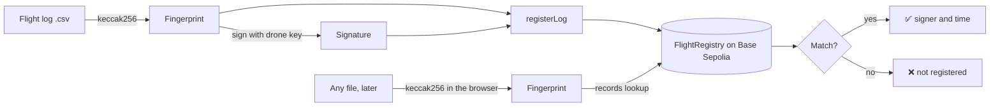

# FlightProof

**A tamper-evident notary for drone flight logs, on Base Sepolia.**

Drop a flight log into the page. It fingerprints the file in your browser and checks that fingerprint against a record on a public blockchain. If the file is the one that was registered, you get a ✅ and the signer. If even one character was changed, you get a ❌.

**Live site:** https://YOUR_GITHUB_USERNAME.github.io/flightproof/
**Demo video (90 s):** https://YOUR_GITHUB_USERNAME.github.io/flightproof/demo.mp4
**Contract:** [`0x1C8E7473272b7879d6e20494c8a04D3eB46de00e`](https://sepolia.basescan.org/address/0x1C8E7473272b7879d6e20494c8a04D3eB46de00e) (Base Sepolia, a test network with no real money)

On the live site, press **Try the original log** and then **Try an edited copy** to see both outcomes without needing a file.

## Why this exists

A flight log is just a file, and a file can be edited after the fact: a GPS track, an altitude, a speed. That matters for incident reviews, insurance, and regulation. FlightProof gives a log a fingerprint that can be checked later by anyone, with no company or database to trust.

## How it works



1. **Fingerprint.** The log is hashed with keccak256. Changing one byte gives a completely different hash.
2. **Sign.** The hash is signed with the drone's private key (`tools/hash_and_sign.py`).
3. **Register.** `FlightRegistry.registerLog(hash, signature)` recovers the signer from the signature with `ECDSA.recover` and stores `{signer, timestamp}` under that hash. A hash can only be registered once.
4. **Verify.** Anyone can hash a file and read `records(hash)` from the contract. No wallet, login or gas is needed, because it is a read.

## Run it yourself

You need [Foundry](https://book.getfoundry.sh/) and Python 3.

```bash
git clone --recurse-submodules https://github.com/YOUR_GITHUB_USERNAME/flightproof.git
cd flightproof
forge test                                   # 3 tests: real log verifies, tampered log is caught, no double registration
tools/check_log.sh sample_logs/flight_001.csv            # ✅ matches the onchain record
tools/check_log.sh sample_logs/flight_001_tampered.csv   # ❌ not registered
python3 -m http.server -d web 8000           # the verify page at http://localhost:8000
```

To register your own log on a test network you need a throwaway key with a little Base Sepolia ETH from a faucet. Put it in a git-ignored `.env` as `PRIVATE_KEY=0x...`, then sign with `tools/hash_and_sign.py <file>` and send with `cast send ... registerLog(bytes32,bytes)`. **Never use a key that holds real funds.**

## Project layout

| Path | What it is |
| --- | --- |
| `src/FlightRegistry.sol` | The smart contract |
| `test/FlightRegistry.t.sol` | Foundry tests |
| `script/DeployFlightRegistry.s.sol` | Deploy script |
| `tools/` | Hash-and-sign script and command-line checker |
| `sample_logs/` | A registered log and several edited or unregistered copies |
| `web/index.html` | The verify page: one file, no build step |
| `demo/` | The narrated demo video |

## What this does and doesn't prove

- A ✅ means this exact file was registered at that time by that signer, and has not changed since.
- It does not prove the data was accurate when the drone recorded it. A wrong log that was registered stays wrong.
- Anyone can register a hash, so the signer shown is whoever signed it. You still need to check that the signer is the drone or operator key you expect. A production version would keep an allowlist of device keys.
- This is a learning project on a test network. It has not been audited.

## Built with

Solidity, [Foundry](https://book.getfoundry.sh/), [OpenZeppelin](https://www.openzeppelin.com/contracts) (ECDSA), [js-sha3](https://github.com/emn178/js-sha3), plain JavaScript and JSON-RPC for the page, Base Sepolia for the chain.

## License

[MIT](LICENSE)
